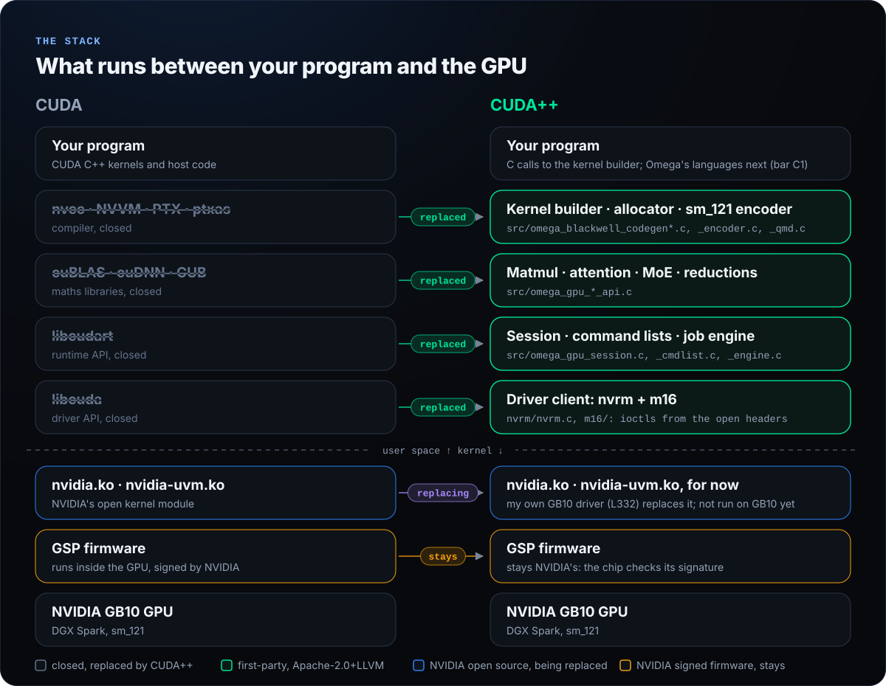
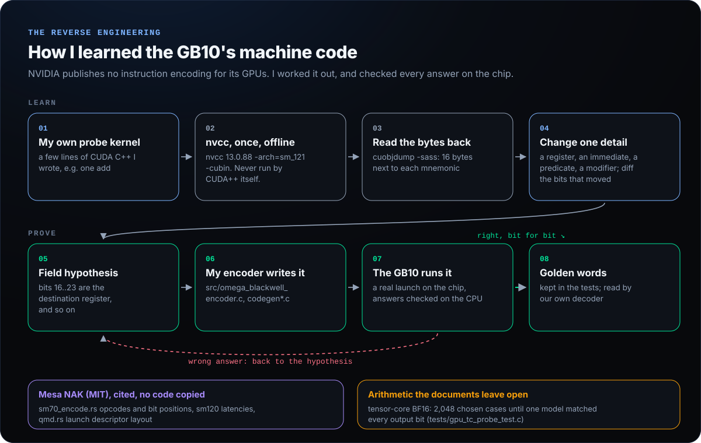
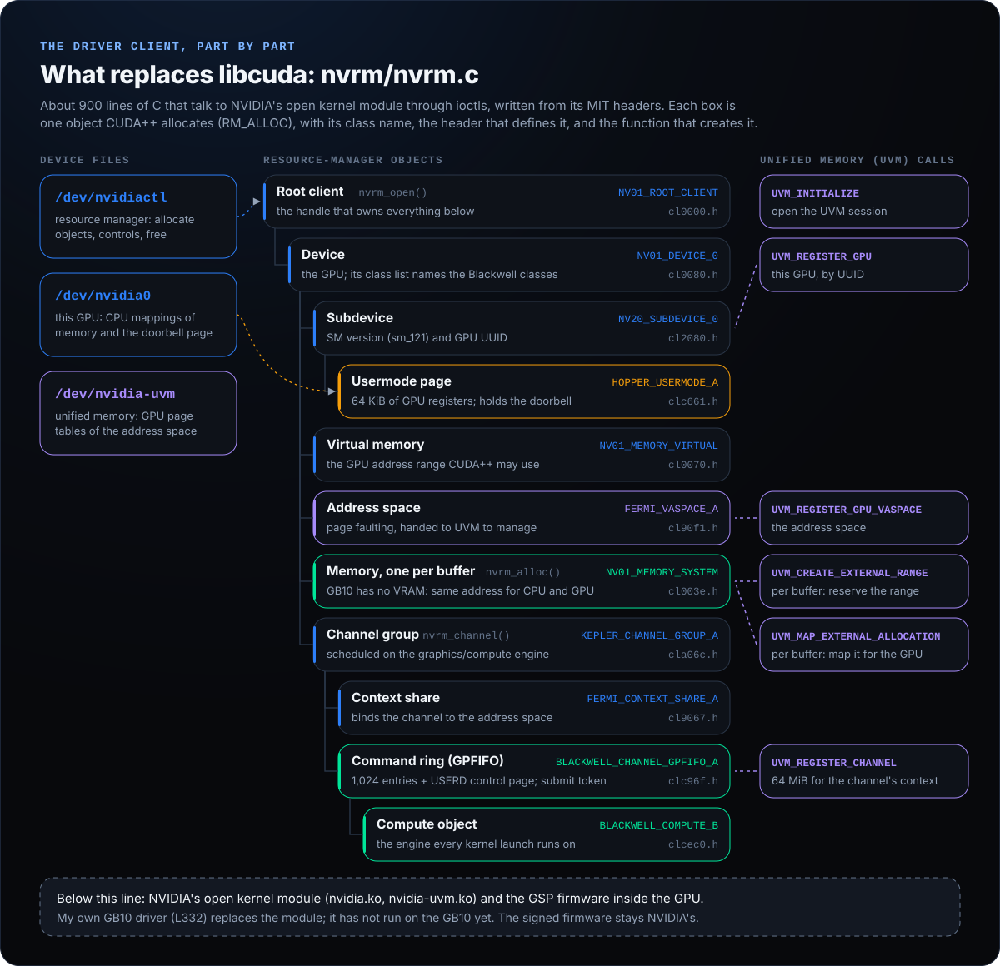
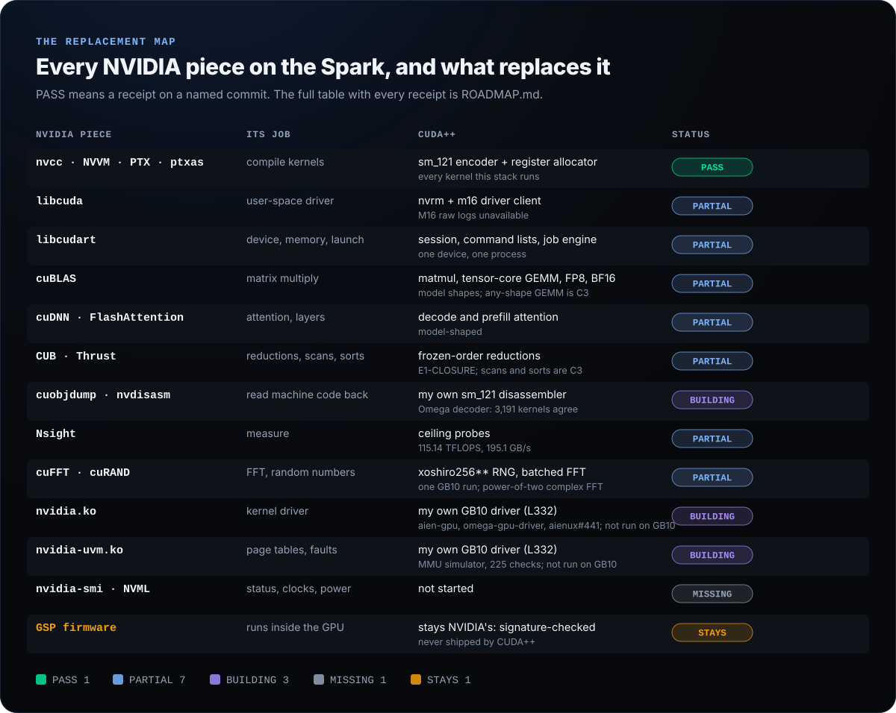

<p align="center">
  
</p>

# 面向 NVIDIA DGX Spark 的 CUDA++

<!-- languages -->
[English](README.md) · **简体中文**
<!-- /languages -->

[](https://doi.org/10.5281/zenodo.23578452) [](https://doi.org/10.5281/zenodo.23614483)

**面向 NVIDIA DGX Spark（GB10，sm_121）的 CUDA++。它是 Omega 运行时的 GPU 部分。本修订版中的第一方 CUDA++ 材料采用 Apache-2.0 WITH LLVM-exception 许可。** 你编写一个 GPU 程序，CUDA++ 把它变成 GB10 自己的机器码，并在 Spark 的 GPU 上运行，构建时和运行时都不需要任何 CUDA 用户态软件：不需要 CUDA 工具包，不需要 `nvcc`，不需要 PTX，不需要 `libcuda`，也不需要 cuBLAS。在摸清编码的过程中，NVIDIA 的编译器和反汇编器只作为离线参照使用（[我是怎么做的](#how-i-did-it)）。NVIDIA 的开源内核模块（580.173.02）和 GPU 上经签名的 GSP 固件仍在这条路径上。这是一套处于研究阶段的工具链和运行时，并不能直接替换整个 CUDA。

> **适用对象与硬件**
>
> | | |
> |---|---|
> | **已支持** | NVIDIA DGX Spark。其 GB10 Grace Blackwell 芯片（GPU 计算能力 sm_121，PCI id `10de:2e12`）仍是唯一有执行凭证的设备。 |
> | **其他 GB10 系统** | 未运行。CUDA++ 按 PCI id 识别 GPU，而不是按整机厂商识别，所以搭载同一内核模块的其他 GB10 系统对代码而言是同一个目标。还没有人在这样的系统上运行过 CUDA++。 |
> | **Ampere 准备工作** | RTX 3090（GA102）和 RTX 3060 Ti（GA104），sm_86：本代码树中已有针对该目标的编码器/cubin、独立显存以及 x86 主机方面的准备工作。两种设备均为 **NOT_RUN**，尚不是已支持/已鉴定的硬件。参见[移植审计](docs/PORT-AMPERE.md)和[设备测试计划](tests/ampere/README.md)。 |
> | **你需要** | 运行在 Spark 的 ARM CPU（aarch64）上的 Linux。NVIDIA 开源内核模块，版本 580.173.02：`make doctor` 和 `make hello-gpu` 会拒绝其他版本，并且 `/dev/nvidiactl`、`/dev/nvidia0` 和 `/dev/nvidia-uvm` 必须存在。NVIDIA 经签名的 GSP 固件，由该模块加载到 GPU 中。`git`、`make` 以及一个 C 编译器。不需要 CUDA 工具包。 |
> | **不支持** | 其他 NVIDIA GPU 未经鉴定。上面准备好的 sm_86 路径没有设备凭证。Omega 的 `rig/gb20x` 分支上有一行针对 RTX 5070（sm_120）的目标，但尚未在该芯片上运行（[可移植性](docs/runtime/PORTABILITY.md)）。其他厂商仍为 PLANNED。多后端划分见 [docs/ARCHITECTURE.md](docs/ARCHITECTURE.md)。不支持未经修改的 CUDA 应用程序：CUDA++ 不编译 CUDA C++ 或 PTX。 |

> **许可状态：** 本修订版的第一方材料采用 Apache-2.0 WITH LLVM-exception。如需历史上的 MIT 版本，请使用 [`232332422bfdc31c8918085b50f13c1e18ab702e`](https://github.com/aien-dev/CUDApp/tree/232332422bfdc31c8918085b50f13c1e18ab702e)。原有的 MIT 授权和第三方声明均已保留。参见[过渡与来源审计](docs/LICENSING_TRANSITION.md)。

它如今运行在 NVIDIA GB10（即 DGX Spark，计算能力 sm_121）上。2026-10-21，Aien 在 Spark 上提供服务的模型 Qwen3.6-35B-A3B（一个混合专家模型，每个 token 约有 30 亿个参数处于激活状态），由本仓库所提取自的 C GPU 栈提供服务（线上构建使用的是 Omega 仓库中这些源码的副本）。线上服务器只映射了 C 库、数学库、`libgcc_s` 和加载器，CUDA 库为零（凭证在 Omega 中：`evidence/WHAT-OMEGA-IS-20261021/live-serve-no-cuda.txt`）。这个栈大部分是 C。其中两部分现在以 Omega 语言编写的代码运行：sm_121 指令编码器（`om/encoder/bw_enc_sm121.om`）和 cubin 打包器（`om/cubin/cubin_elf.om`），由固定版本的 Omega 编译器编译，并通过一个 omega-bridge 绑定链接。它们的 C 实现已移出默认构建，只作为差分参照基准保留；在测试套件构建的每一个核函数上，.om 编码器与 C 编码器的输出逐字节一致（[证据](evidence/CUDAPP-OM-ENCODER/README.md)，迁移表见 CUDApp#79）。其余部分（核函数构建器、寄存器分配、运行时）仍是 C。由 Omega 编译器自身把 Omega 程序编译到 GPU，是 Omega 的 C1 门槛。截至 2026-10-29，它已在 GB10 上 EXERCISED，但只在草稿 PR 中，尚未合并：用 Omegese 编写的核函数在芯片上运行，645 项检查 0 项失败（[omega-mv#885](https://github.com/aien-dev/omega-mv/pull/885)），其降级同样用种子自举的 `.om` 编写；把 35B 解码门禁换成 Omegese 版本后，在一台测试服务器上得到了黄金标准 token（[omega-mv#886](https://github.com/aien-dev/omega-mv/pull/886)）。2026-10-29 时，这两个拉取请求仍是打开状态的草稿。它们使用的是 omega-mv 自己的 sm_121 编码器副本，而不是固定版本的 CUDA++。

CUDA++ 正在不断扩展，以覆盖 NVIDIA 用户态软件在 Spark 上承担的工作，进而做到 CUDA 做不到的事：

- 我自己的 GB10 内核驱动将取代 NVIDIA 的开源内核模块 `nvidia.ko` 和 `nvidia-uvm.ko`。它正在三个仓库中构建，其中还没有一个在 GB10 上运行过：aien-dev/aien-gpu（Linux 模块中的 Omega 单元；主机测试和 QEMU 测试通过）、aien-dev/omega-gpu-driver（基于 `vfio-pci` 的种子自举 Omega；步骤 W0 仅在 QEMU 中执行过）以及 aienux#441（账本 L332：C 参考驱动和 GB10 模拟器，aien-gpu 的启动步骤以它们为准进行检查）。在其中一个于芯片上通过之前，CUDA++ 运行在 `nvidia.ko` 580.173.02 上。途中测得的 GB10 事实（芯片 id、启动序列）仍会作为发现提交给上游的 Linux 驱动 Nova 和 nouveau；
- 我自己的反汇编器取代 `nvdisasm`；
- GSP 固件也仍然是 NVIDIA 的，原因是物理上的：GPU 会检查其签名，不会启动任何其他固件；
- 超越 CUDA：掌控从程序到芯片的整条路径，从而做到每个生成的词只需一次提交、整模型核函数常驻 GPU，以及对 CPU 与 GPU 共享内存的零拷贝使用。

CUDA++ 与 NVIDIA 没有隶属关系，也未获其背书；CUDA 是 NVIDIA 的商标。

**初次接触 CUDA++？** 请从[首次运行与独立验证指南](docs/START_HERE.md)开始。它把仅在主机上运行的测试与真实的 GB10 执行区分开，说明当前的支持边界，并解释如何解读凭证。在部署中依赖它之前，请先阅读[贡献指南](CONTRIBUTING.md)、[安全问题报告](SECURITY.md)和[就绪路线图](ROADMAP.md)。

**本页内容：** [技术栈](#the-stack) · [我是怎么做的](#how-i-did-it) · [机器码](#what-the-machine-code-looks-like) · [驱动，逐部分](#the-driver-part-by-part) · [一次启动，从头到尾](#one-launch-start-to-finish) · [CUDA，逐件对照](#cuda-piece-by-piece) · [速度](#speed-against-the-ceiling) · [运行你的第一个核函数](#run-your-first-kernel)

## TileLab 驱动检查与重放

`make test-tilelab-host TILELAB_OMC=/path/to/pinned/omc` 会运行驱动的仅主机拒绝检查和参照基准检查，然后运行 `tests/tilelab_host_fault.om` 中有界的 Omega 编排器。编译器必须与 `tools/c5/omc.pin` 一致。单独编译的 `gpu_tilelab_host_fault` 把每个 GEMM 和配置入口替换为不委托的 CPU 故障注入；它不会调用 GPU 或会话入口点。它的凭证写明 `execution: synthetic-host`。这些结果是主机控制流方面的证据，绝不是芯片鉴定。

编排器会检查：形状列表的全部容量、转义后的 JSON 标识符、预热调用和计时调用失败、运行时失败的变异体、成功执行但结果错误的变异体、结果正确的负对照，以及在 `/dev/full` 上的缓冲凭证写入失败。运行时错误不能算作捕获到的变异体。凭证写入或关闭失败时，会在最终 PASS 之前返回非零值。arm 名称必须是有效的 UTF-8。JSON 会精确保留多字节标识符，转义引号、反斜杠和控制字符，并在任何执行或凭证创建之前拒绝格式错误的 UTF-8。

用 `make tilelab-replay TILELAB_OMC=/path/to/pinned/omc` 构建当前的重放程序。其接口如下：

```text
build/tilelab_replay DRIVER OUTPUT_PREFIX "M,N,K;..." ROUNDS [NAME:RT,CT,WM,WN,BAND ...]
```

它直接调用驱动，不经过 shell，每次调用最多编组十五个显式配置，因为默认 arm 占用了剩下的一个位置。输出为 `OUTPUT_PREFIX.0.json`、`.1.json`，依此类推。每个子进程都必须成功；子进程非零退出、执行失败和信号都会让重放停止，且不会打印重放 PASS。主机编排器会检查失败的传播，以及跨越三次调用的配置列表。

使用真实设备驱动仍需要操作员当前的 GPU 窗口授权。构建重放程序或通过主机测试都不会授予这一授权。`evidence/TILELAB-20261028/` 下的脚本和凭证是不可更改的历史记录，而不是当前可执行的门禁。特别是，归档的扫描脚本可能掩盖子进程失败和超容量的分组。新的运行请使用当前的重放程序；不要改写历史脚本或凭证。

<a id="the-stack"></a>
## 技术栈

<p align="center"></p>

在 CUDA 程序与 GPU 之间有四个闭源的 NVIDIA 层：编译器、数学库、运行时和驱动库。CUDA++ 用自己的代码完成它们的工作，目前处于研究阶段。它们之下是源码由 NVIDIA 公开的内核模块，以及 GPU 内部的固件。CUDA++ 目前直接与内核模块通信。我自己的 GB10 驱动将取代该模块；它尚未在 GB10 上运行过。固件仍然是 NVIDIA 的。

<a id="how-i-did-it"></a>
## 我是怎么做的

<p align="center"></p>

我独自一人在一台 DGX Spark 上用不到四周时间完成了它，过程中指挥 AI 编程智能体。NVIDIA 公开了其 Linux 内核模块的源码，但没有公开它的编译器、驱动库或 GPU 的机器码。所以我跳过了每一个闭源层：

1. **不用 libcuda。** 我依据开源内核模块的 MIT 头文件，为它的 ioctl 编写了自己的客户端：客户端、设备、地址空间、内存、命令环、计算对象、门铃、完成通知。[驱动，逐部分](#the-driver-part-by-part)展示了每一个部分。
2. **不用 nvcc，不用 PTX。** GPU 的机器码没有公开文档，所以我对它做了逆向工程：用 NVIDIA 的编译器把我自己写的小型探测核函数编译一次，再用 NVIDIA 的反汇编器读回机器码，比较只有一处细节不同的核函数，找出哪些位表示什么，并与 Mesa 的开源 NVIDIA 编译器交叉核对；在芯片运行并给出正确答案之前，什么都不相信。文档没有确定的算术行为（张量核心）在芯片上反复测量，直到模型与每一个输出位都吻合。
3. 在此之上是**我自己的编码器、运行时和库**：59 种指令、一个寄存器分配器、启动描述符、命令列表、矩阵乘法、注意力。

我不是唯一一个公开绘制这套指令集的人，我也要向其他人致谢：Mesa 的 NAK 编译器有一个针对 `nvdisasm` 测试过的 SM120 编码器；[cubit](https://github.com/kacper-daftcode/cubit) 是一个面向 SM120 和 SM121a 的 MIT 许可汇编器与反汇编器；[blackwell-isa](https://github.com/kacper-daftcode/blackwell-isa) 发布了一张 sm121a 编码表；[nvidia-sass-document](https://github.com/cicuvc/nvidia-sass-document) 记录了 SASS 编码；tinygrad 的 NV 后端与同一个开源内核模块接口通信。用它们交叉核对 CUDA++ 目前为 PROPOSED。

<p align="center"></p>

当前代码树中没有存放任何 NVIDIA 二进制文件或 NVIDIA 工具的输出清单。以前用 `nvdisasm` 固定 CUDA++ 自身 trace-emitter 字的测试已在 #93 中移除；其历史记录在 `PROVENANCE.md` 第 6 节。完整的方法，连同文件和凭证逐步说明：[docs/HOW_I_DID_IT.md](docs/HOW_I_DID_IT.md)。

<a id="what-the-machine-code-looks-like"></a>
### 机器码是什么样子

每条 GB10 指令都是 16 字节。低位说明做什么、对哪些寄存器做；最高的 23 位告诉 warp 调度器在下一条指令之前要等待多久，以及要等待哪些先前的结果。下面是第一个核函数中的加法指令，每一位都有交代：

<p align="center"></p>

这些调度位通常由编译器隐藏起来。慢指令（内存加载、常量加载、特殊寄存器）会设置六个记分板中的一个；之后需要该结果的指令就在这个记分板上等待。下面是完整的第一个核函数，并画出了它的各处等待：

<p align="center"></p>

这些位中只要有一位出错，也不会明显地报错：GPU 会在加载完成之前读取寄存器，并返回一个错误的数。正因如此，每一种编码在测试中都有黄金字，背后还有一次芯片运行。本页中的图由 `tools/figures/make_figures.py` 根据仓库自身的数据绘制；上面两张图解码的是 `src/omega_blackwell_encoder.c` 中的字。

<a id="the-driver-part-by-part"></a>
## 驱动，逐部分

`libcuda` 是闭源的，但它对硬件做的一切都经由三个设备文件上的 ioctl 完成，而 NVIDIA 的开源内核模块在其公开头文件中定义了每一个这样的调用。我原样复制了其中 67 个头文件（`third_party/nvidia-open-580.173.02/`，MIT），并针对它们编写了自己的客户端。全部内容如下：

<p align="center"></p>

| 部分 | 位置 | 作用 |
| --- | --- | --- |
| 打开 | `nvrm/nvrm.c` 中的 `nvrm_open()` | 打开 `/dev/nvidiactl` 和 `/dev/nvidia-uvm`，找到 GPU（`NV_ESC_CARD_INFO`），分配根客户端、设备和子设备，读取类列表以选择 Blackwell 类，读取 SM 版本和 GPU UUID，映射存放门铃的 64 KiB 用户态页面，并创建一个由统一内存驱动管理的地址空间。 |
| 内存 | `nvrm_alloc()`，`nvrm_free()` | 每个缓冲区一个系统内存对象。GB10 没有独立显存，所以每个缓冲区对 CPU 和 GPU 都映射在**同一地址**：指针在两侧含义相同，不需要任何拷贝。CPU 轮询的所有内容都以 GPU 不缓存的方式分配（`nvrm_alloc_gpu_uncached()`）。 |
| 通道 | `nvrm_channel()` | 通道组、上下文共享、一个带 USERD 控制页面的 1,024 项命令环，以及 Blackwell 计算对象。获取通道的工作提交令牌，向统一内存驱动注册该通道，并开启调度。 |
| 提交 | `nvrm_enqueue()`，`nvrm_ring()` | 写入一个 8 字节的环条目（pushbuffer 地址和长度），在完整内存屏障下推进 `GPPut`，然后敲响门铃：对令牌做一次 32 位存储。启动工作无需任何系统调用。 |
| 等待 | `m16/m16_gpu_wait.c` | 唯一的完成等待：轮询 GPU 写入的一个字，带有一个永不延长的硬截止时间，以及一个只在有进展时才重新计时的停顿截止时间。 |
| 鉴定 | `m16/m16_requalify.c`，`m16/m16_concurrent.c` | 芯片上的证明。Requalify 在**不**敲门铃的情况下排队工作，检查 100 ms 内没有任何动静，然后敲门铃，检查标记变为 `0x16c0ffee`，并读取 `/proc/self/maps` 以证明 `libcuda` 从未被加载。Concurrent 运行两个通道，并检查它们都无法触发对方。 |
| 平台契约 | `src/omega_gpu_platform.h` | 运行时可以向机器请求什么：用类型化句柄代替文件描述符，每个缓冲区都有显式权限，没有静默回退。上面的 Linux 客户端是其中一种实现；AIEN 自己的驱动从同一接缝接入。 |
| 会话、命令列表、引擎 | `src/omega_gpu_session.c`，`src/omega_gpu_cmdlist.c`，`src/omega_gpu_engine.c` | 每个进程一个设备，保持打开；多次启动记录进一次提交；一个作业运行器，返回成功或恰好一个具名失败，并且如果无法判断 GPU 是否已完成，就拒绝后续所有 GPU 工作。 |

RM/UVM 参数块由 `native/nvrm/struct.om` 中的种子自举 Omega 编解码器填充和解码，使用的是实测的 580.173.02 头文件布局。`CUDAPP_MIGRATION_PENDING_C_NVRM_STRUCT=1` 会为迁移参照基准选择旧的 C 参数填充；其默认值为 **0**，即 Omega 路径。原始 ioctl 调用仍在 C 中。共享的 UVM 实现保留了较旧的固定大小导出，而结构体入口使用精确大小的视图。参见[主机证据与芯片操作手册](evidence/NVRM-STRUCT-OM/README.md)：字节/布局差分和变异体属于主机证据，而不是真实 RM 上的鉴定。

头文件里没有写的东西，我在芯片上学到，并记成规则，每条规则背后都有一份凭证或一个 issue：

- **CPU 轮询的字必须是 GPU 不缓存的。** 否则 GPU 会把新值留在自己的 L2 缓存里，CPU 永远看不到它的变化。这曾在 2026-10-02 让工作停滞过一次；平台现在会拒绝这样的缓冲区。
- **新代码在运行前需要使着色器缓存失效。** GPU 的指令缓存看不到 CPU 的写入；一个代码地址被重用后，芯片运行的是旧指令。现在每次上传代码的启动都以 `INVALIDATE_SHADER_CACHES` 开头（凭证 FB1-CUT1B-4345406，在 Omega 中）。
- **相互依赖的启动之间需要等待空闲。** 没有这一步，同一通道上的两个网格可能重叠。启动命令的顺序遵循 Mesa 的 NVK 驱动。
- **Blackwell 的控制页面不报告读指针。** 客户端自己统计已完成的环条目，绝不覆盖尚未确认完成的条目。
- **创建计算对象需要一个空闲的、物理连续的 2 MiB 块**作为其上下文缓冲区。在繁忙的主机上，这样的块会短暂缺失，因此这一次分配会有限次地重试（omega#523）。

客户端之下：NVIDIA 的开源内核模块（`nvidia.ko`，`nvidia-uvm.ko`）以及 GPU 内部的 GSP 固件。我自己的 GB10 驱动将取代该内核模块（aien-dev/aien-gpu、aien-dev/omega-gpu-driver 和 aienux#441，L332；都还没有在 GB10 上运行过）。客户端使用 NVIDIA 的 ioctl 接口，因此把它迁移到我的驱动上是替换工作的一部分；这一迁移为 PROPOSED，尚未开始。固件仍然是 NVIDIA 的，因为芯片会检查其签名。按顺序列出的每个对象和调用，附带行号引用：[docs/DRIVER.md](docs/DRIVER.md)。

<a id="one-launch-start-to-finish"></a>
## 一次启动，从头到尾

<p align="center"></p>

CPU 做五件事，除最后一件外都是普通的内存写入，最后一件是对一个 GPU 寄存器的单次存储。之后 GPU 自行完成其余工作：取回环条目，读取命令，读取启动描述符（QMD：网格大小、块大小、寄存器、共享内存、代码地址），运行网格，并写入两个完成标记，两者之间有一次缓存刷新。结果已经在 CPU 可以读取的内存中。把多次启动记录进一次提交（`src/omega_gpu_cmdlist.c`），就是一个完整的生成词一次性送到 GPU 的方式。

<a id="cuda-piece-by-piece"></a>
## CUDA，逐件对照

<p align="center"></p>

| CUDA 组件 | 职责 | CUDA++ 替代品 | 状态 |
| --- | --- | --- | --- |
| CUDA C++ 语言 | 如何编写核函数 | 核函数构建器（C 调用）。让 Omega 的语言直达 GPU 是 Omega 的 C1 门槛，构建在这条工具链之上 | PARTIAL：这里是 C 调用；Omegese 核函数已在 omega-mv 草稿 #885/#886 中于 GB10 上 EXERCISED（尚未合并） |
| nvcc、NVVM、PTX、ptxas | 把核函数编译为机器码 | 我自己的 sm_121 编码器和寄存器分配器 | PASS：这个栈运行的每一个 GPU 核函数都由它编码 |
| libcuda（驱动 API） | 与内核驱动通信 | `nvrm` 客户端，ioctl 直达开源内核模块 | PARTIAL：已实现；M16 的历史摘要在这里无法审计（见下文） |
| libcudart（运行时 API） | 设备、内存、启动、流 | 会话、命令列表、作业引擎 | PARTIAL：一个设备，一个进程；尚无流或事件；一次超时会终止该进程对 GPU 的使用 |
| cuBLAS | 矩阵乘法 | Matmul、张量核心 GEMM、FP8 和 BF16 库，以及通用的 `omega_gpu_gemm_ex`（任意 M、N、K，op N/T，前导维度，alpha/beta，跨步批次，f32/bf16/f16/e4m3/e5m2 输入，fp8 缩放） | PARTIAL：快速核函数是按 AIEN 运行的模型定制的。`gemm_ex` 接受任意形状（在已合并的核函数上做了 902 项芯片检查，`evidence/GEMM-GENERAL-00c9cf9/`；更早的 `evidence/GEMM-GENERAL-fba0384/` 中的 901 项检查早于主线合并），但它从主机内存运行，k 方向求和在主机上完成，所以不是服务路径；f32 实为 bf16x3，而不是 IEEE fp32；没有 fp8 输出（`docs/runtime/API.md` 9.8） |
| cuDNN、FlashAttention | 注意力和网络层 | 解码和预填充注意力 | PARTIAL：融合的快速路径按模型定制；自运行时 API 0.6.0 起，一个通用回退（`omega_gpu_attention_general`，EXPERIMENTAL）接受 head_dim 1..256、任意 MHA/GQA/MQA 比例、因果或非因果、滑动窗口和任意长度，已在 GB10 上经过芯片执行（`evidence/ATTN-GENERAL-20261027-4d51f91f/`）。它是一个不使用张量核心的标量 f32 核函数，不支持 ALiBi、softcap 或 dropout |
| CUB、Thrust | 归约、扫描、排序 | 固定顺序的归约（`evidence/E1-CLOSURE/`） | PARTIAL：没有通用的扫描或排序 |
| cuFFT、cuRAND | FFT、随机数 | xoshiro256** 和 Philox4x32-10 随机数，提供 cuRAND 的 uniform、uniform_double、uniform2_double 和 normal 分布；复数、实数（R2C/C2R）以及 2-D/3-D FFT，和 cufftPlanMany 布局，长度从 2 至 4096 任意；核函数和计算轮次计划由种子自举 Omega 单元 `om/mathlibs/mathlibs_ir.om` 构建 | PARTIAL：xoshiro256** 和复数 FFT 在 GB10 上运行过一次，4 至 2048 点（`evidence/MATHLIBS-RNG-FFT-2026-10-27/`）。2026-11-06：Philox（cuRAND 流）、R2C/C2R 8 至 4096 点以及 2-D/3-D 变换仅通过主机和模拟器检查，芯片 NOT_RUN（`evidence/MATHLIBS-PHILOX-RFFT-ND-2026-11-06/`）。2026-11-06：Philox 分布、非二的幂长度（混合基、Bluestein）和 cufftPlanMany 布局仅通过主机和模拟器检查，芯片 NOT_RUN（`evidence/MATHLIBS-GAPS-2026-11-06/`）；尚无 `curand_normal_double` |
| cuobjdump、nvdisasm | 读回机器码 | 我自己的 sm_121 反汇编器 | BUILDING：解码器是种子自举 Omega 单元 `om/disasm/sm121_dis.om`；2026-11-05，它在该库构建的全部 3,191 个核函数上与 `nvdisasm` 结果一致（仅主机；没有在芯片上运行任何东西）。常规主机测试使用它；`nvdisasm` 只在具名的参照基准目标中运行 |
| Nsight | 测量 | 上限探测：张量核心峰值 115.14 TFLOPS，读取 195.1 GB/s（`evidence/OWN30B-T3-TC-PEAK-BW-5faa0f70-20261013T2236Z/`） | PARTIAL：只有探测，没有统一的工具 |
| CUDA 示例、文档 | 你的第一个核函数 | `examples/hello_gpu`，`docs/runtime/` | PARTIAL：一个示例 |
| `nvidia.ko`，`nvidia-uvm.ko` | 内核驱动 | 我自己的 GB10 驱动：aien-dev/aien-gpu、aien-dev/omega-gpu-driver、aienux#441（L332） | BUILDING：只有主机、QEMU 和模拟器结果；还没有任何东西在 GB10 上运行，`nvrm` 客户端仍使用 NVIDIA 的 ioctl。各条线的凭证见 `ROADMAP.md` |
| GSP 固件 | 在 GPU 内部运行 | 仍然是 NVIDIA 的（由芯片检查签名） | 不可替换 |

PASS 表示在一个具名提交上存在凭证。状态词来自 Omega 的 `docs/OMEGA.md` 第 2 节。`ROADMAP.md` 列出了 Spark 上的每一个 NVIDIA 组件及其凭证，以及 CUDA++ 在声称“取代 CUDA”之前必须通过的门槛。

默认的 mathlibs 主机路径同样是种子自举 Omega：`om/mathlibs/host.om` 负责 RNG 准入和种子算术、FFT 准入和启动遍历、混合基/Bluestein 规划、布局/重叠检查以及毒值计数。六个类型化入口单元在 `om/units.sh` 中注册；它们生成的 C 绑定已提交入库。C 文件保留会话、分配、时钟、表复制和回调这些副作用。旧的主机计算只有在打开默认关闭（OFF）的 `CUDAPP_MIGRATION_PENDING_C_MATHLIBS_HOST` 参照基准标志时才会编译。

在不暴露 GPU 设备的情况下，运行聚焦的主机差分测试、红色对照和缺失单元对照、参照基准 gcov，以及八个种子源码变异体：

```sh
export OMEGA_OMC=$HOME/work/cudastack/omega-mv/seed/out/omc
export OMEGA_BRIDGE=$HOME/work/cudastack/omega-bridge
bwrap --dev-bind / / --dev /dev --proc /proc -- taskset -c 10-14 nice -n 10 make test-mathlibs-host-om
bwrap --dev-bind / / --dev /dev --proc /proc -- taskset -c 10-14 nice -n 10 make -j3 test-gpu-mathlibs
```

主机迁移证据和单独的、尚未运行的芯片流程在 `evidence/mathlibs-host-20261106/README.md` 中。这些检查不能鉴定 GPU 执行，不会改变公开 API，也不会取代历史芯片凭证。

导入的 `evidence/m16-blackwell-native-path-requalification-receipt.json` 是一份**无法审计的历史摘要**，不是对当前检出版本的鉴定。它列出了实现提交 `a2c0d7fbc03f7ce91fcb6389312a0ee8630322cd`，但它的 `evidence/m16-requalification` 原始日志和已被取代的凭证不在本仓库中。其历史上的 PASS 和持久性字段原样保留，但不被认可为当前证据。对于那些缺失的日志，尚未确立任何不可变的持久来源。当前的原生鉴定为 **NOT_RUN**；它需要来自一次新的、经授权的 GPU 运行并保留下来的原始日志，而不是仅在主机上的检查。

<a id="speed-against-the-ceiling"></a>
## 与上限对照的速度

<p align="center"></p>

每一个速度数字都以这台机器在物理上能做到的上限为参照，上限由我自己的探测核函数测得。生成一个文本词要把每个激活的权重读取一次，大约每字节做一次运算，远在屋脊点左侧，所以它的速度由内存决定，而不是由张量核心决定。在这台 Spark 上与 llama.cpp 和 vLLM 的正面对比测量是 Omega 的 P0 门槛（AIEN L394），尚未发布。在发布之前，本仓库不主张任何与 CUDA、llama.cpp、vLLM 或 TensorRT 的速度对比。其预先声明的测量规程在 [aien-dev/gpu-head-to-head](https://github.com/aien-dev/gpu-head-to-head) 中，该规程按提交固定本仓库；原始日志和结果将在那里发布。纯芯片时间（每个 token 的 GPU 时间）和端到端时间（经过 HTTP 服务器，包含提示词）是不同的测量，始终分开标注；其他项目发布的数字属于它们自己，这里没有重新测量。

## 这里有什么

| 部分 | 作用 | 位置 |
| --- | --- | --- |
| GPU 工具链 | 直接写出 sm_121 机器码（SASS）：一个支持 59 种指令的核函数构建器、一个寄存器分配器、指令编码器、启动描述符（QMD） | `src/omega_blackwell_codegen*.c`，`src/omega_blackwell_encoder.c`，`src/omega_blackwell_qmd.c` |
| GPU 运行时 | 打开设备、分配内存、上传代码、启动核函数、记录命令列表、运行作业。相当于 CUDA 运行时和驱动 API 的工作 | `src/omega_gpu_session.*`，`omega_gpu_cmdlist.*`，`omega_gpu_engine.*`，`omega_gpu_platform*` |
| 库 | 矩阵乘法和矩阵向量乘法（BF16、FP8、4 位、三值）、用于解码和预填充的注意力、逐元素运算、混合专家路由。相当于 cuBLAS 和 cuDNN 的工作 | `src/omega_gpu_*_api.*` |
| 驱动客户端 | 通过 ioctl 与 NVIDIA 的开源内核模块通信；取代 `libcuda` | `nvrm/`，`m16/` |
| NVIDIA 接口头文件 | 开源内核模块的公开接口定义（MIT，未修改） | `third_party/nvidia-open-580.173.02/` |
| 运行时 API | 成文的、带版本号的 API 及其清单检查 | `docs/runtime/API.md`，`src/omega_runtime_api.h` |
| 图 | 本页的每一张图，都根据仓库自身的数据绘制 | `tools/figures/make_figures.py`，`docs/img/` |

## CUDA 的痛点，以及 CUDA++ 如何解决

我阅读了开发者在 GitHub、Reddit、NVIDIA 论坛、PyTorch 论坛、Hacker News 和 Stack Overflow 上关于 CUDA 及其库的讨论，并按受影响的人数给问题排序（GitHub issue 数量乘以影响的严重程度）。完整的调研共有 97 个来源，每一条引文都逐字对照原页面核对过，见 `docs/PAIN_POINTS.md`。CUDA++ 本身是如何构建的（包括逆向工程），见 `docs/HOW_I_DID_IT.md`。

下面每一行都给出：开发者用自己的话描述的痛点，CUDA++ 如何解决它，以及展示这一点的命令，附带它在我的 DGX Spark 上打印的输出和它所来自的凭证。只有当该命令和凭证都在这个分支上时，这一行才会标为 FIXED。CUDA 仍然更好的地方，`docs/PAIN_POINTS.md` 第 4 节会如实说明。

### 1. 内存不足，而在 DGX Spark 上则是整机冻结（26,390 个 GitHub issue 提到 “CUDA out of memory”）

**痛点。** “Spark 出厂时 swap 为零。在统一内存上，一次峰值会直接引发全局 OOM，把整台机器彻底卡死。ssh 不通，ping 不通，只能断电重启。”（[dgx-spark-laguna FINDINGS.md](https://github.com/sudoingX/dgx-spark-laguna/blob/main/FINDINGS.md)）

**CUDA++ 如何解决。** 在 GB10 上，CPU 和 GPU 共享同一块内存，每个 CUDA++ 缓冲区都是其中的一部分。CUDA++ 没有缓存分配器，所以一个进程持有的就是它申请的。在任何分配到达驱动之前，CUDA++ 会检查机器还有多少空闲内存。如果这个缓冲区会让剩余内存低于保留量（默认 4 GiB，用 `CUDAPP_MEM_RESERVE_MIB` 修改，设为 0 则关闭），这次分配就会被拒绝，并给出一句说明，而不是让机器冻结。

**展示这一点的命令**（运行时在模拟驱动上的主机测试，在 Spark 上运行）：

```
$ make build/test_omega_gpu_platform_linux && ./build/test_omega_gpu_platform_linux
...
  refusal: dma_alloc: refused 2.0 MiB: 4.0 GiB of memory is free and CUDA++ keeps 4.0 GiB free (CUDAPP_MEM_RESERVE_MIB=4096), because the CPU and GPU share it and running it out freezes the machine. Free buffers or use a smaller batch.
  session: dma_alloc: refused 2.0 MiB: 4.0 GiB of memory is free and CUDA++ keeps 4.0 GiB free (CUDAPP_MEM_RESERVE_MIB=4096), because the CPU and GPU share it and running it out freezes the machine. Free buffers or use a smaller batch.
PASS D1_MEMORY_RESERVE_REFUSES_BEFORE_THE_DRIVER
test_omega_gpu_platform_linux (reference only, simulated driver): 9 passed, 0 failed
```

凭证：`evidence/dx/d1-memory/platform-test-spark.txt`，以及 `evidence/dx/d1-memory/negative-control.txt`（去掉这项检查后，测试失败）。**已在运行时中 FIXED，在主机上展示。** 尚待完成：在芯片本身上、在一个 GPU 窗口内展示同样的拒绝（`docs/issues/D1-memory.md`）。

### 2. 版本与构建矩阵（11,034 个 GitHub issue 提到 “TORCH_CUDA_ARCH_LIST”）

**痛点。** “我不知道有什么正确的方案能适用于所有环境，欢迎提建议。”（FlashAttention 的维护者，[flash-attention #246](https://github.com/Dao-AILab/flash-attention/issues/246)）

**CUDA++ 如何解决。** 不存在需要匹配的工具包版本：编译器、运行时和库是同一个仓库中的同一个提交，用 `make` 和一个 C 编译器构建。唯一的外部版本是 NVIDIA 的内核模块，CUDA++ 基于其公开头文件构建。`make doctor` 会检查它以及首次运行所需的其他一切。它只读取 `/proc`、`/sys` 和 `/dev`，不打开任何设备。每个问题都会得到一行说明：哪里不对、为什么，以及修复它的命令。**doctor 包装器**会拒绝其他版本的模块；`make hello-gpu` 会先运行这个包装器。直接链接该库的程序会在打开设备时得到库自身的 GPU 准入检查（运行时 API 0.14.0）：未知或未经鉴定的 PCI id 会在任何 `/dev/nvidia` 节点被打开之前被拒绝，并给出一句说明。驱动版本检查仍然只在 doctor 中。该诊断不是沙箱，也不是对当前提交的鉴定；调用方必须自己完成兼容性预检，并且要有经授权的 GPU 窗口。

**展示这一点的命令：**

下面的摘录是历史上的 doctor 输出；当前输出会明确把 M16 凭证标注为历史摘要，且原始证据不可用。

```
$ make doctor
cudapp doctor: is this machine ready for CUDA++?
  info  system: Linux 7.0.0-1019-nvidia aarch64
  ok    NVIDIA kernel module: open module 580.173.02 (CUDA++ speaks 580.173.02)
  ok    device files: /dev/nvidiactl /dev/nvidia0 /dev/nvidia-uvm can be opened by this user
  ok    GPU 000f:01:00.0: NVIDIA GB10 (sm_121), qualified (receipt: evidence/m16-blackwell-native-path-requalification-receipt.json)
  ok    memory: 121.7 GiB shared by the CPU and the GPU, 61.3 GiB available now
  info  CUDA toolkit: not needed and not used by CUDA++ (one is installed at /usr/local/cuda/bin/nvcc; that is fine)
  info  compiler: this doctor was built by 13.3.0; CUDA++ needs only make and a C compiler
READY. Next: make hello-gpu
```

在一台装有错误模块的机器上（`CUDAPP_DOCTOR_SHOW=1 sh tests/doctor/run.sh build/cudapp-doctor` 构建的九台模拟机器之一）：

```
  FAIL  NVIDIA kernel module: version 575.64.05 is loaded; CUDA++ speaks the 580.173.02 interface
        Why: CUDA++ builds its driver calls from the 580.173.02 open-module headers
        (third_party/nvidia-open-580.173.02). The layout of those calls can change between module versions,
        and a wrong layout fails in strange ways, so CUDA++ refuses instead of guessing.
        This is the only version CUDA++ asks you to match: no toolkit, no framework build, no extension build.
        Do this: install the 580.173.02 open kernel module, or port the client to your version
        (CONTRIBUTING.md, "Port a driver version": copy the new headers, rebuild, run make test and make hello-gpu).
```

凭证：`evidence/dx/d2-doctor/make-doctor-spark.txt`，`evidence/dx/d2-doctor/fake-machines.txt`，`evidence/dx/d2-doctor/negative-control.txt`。**FIXED。**

### 3. 错误报告得太晚，而且报在错误的调用上（10,356 个 GitHub issue 提到 “CUDA_LAUNCH_BLOCKING”）

**痛点。** “根据我们的经验，这类异常的 Python 调用栈基本上总是不正确的，几乎毫无用处。”（vLLM 的维护者，[vLLM 博客](https://vllm.ai/blog/2025-08-11-cuda-debugging)）

**CUDA++ 如何解决。** CUDA++ 的启动默认会等待自身完成，因此错误会从引发它的那个调用返回。而且，只需一个标志，同一个核函数程序就能在 CUDA++ 的主机 warp 模拟器上运行，在那里每一次全局访问都会对照这次启动所给的缓冲区进行检查。一次错误访问会让运行在那次启动处停止，并指明核函数、启动、指令、块和线程、地址、它越出的缓冲区及越出多少，以及下一步该怎么做。

**展示这一点的命令**（`--bug=past-end` 给最后一次启动多传了一个元素，即经典的差一错误）：

```
$ build/hello_gpu --sim --bug=past-end
FAULT at launch 8 of 8 of kernel vecadd (simulator): global load outside every buffer
  launch: grid 1025 x 1 blocks of 128 threads, n = 131073, first element 917504
  instruction: 11 of 19, LDG.E (4-byte load)
  thread: block 1024, thread 0 (element 1048576 of the whole job)
  address: 0xeba6fbc6f040 (4 bytes), 0 bytes past the end of buffer a = [0xeba6fb86f040, 0xeba6fbc6f040) (4194304 bytes)
  simulator: MEM at pc 11: global access outside the declared buffers
  next: launch 8 was given n = 131073, and buffer a holds 131072 elements from this launch's first element.
        Fix the launch or the buffer, run hello_gpu --sim until it passes, then run hello_gpu on the GPU.
```

凭证：`evidence/dx/d3-faults/fault-report-spark.txt`，`evidence/dx/d3-faults/test-hello-sim.txt`，`evidence/dx/d3-faults/negative-control.txt`（关闭边界检查后，故障检查会失败）。**已在模拟器上 FIXED。** 尚待完成：在芯片上，出故障的核函数仍然表现为一次永远不会完成的启动，随后进程会拒绝后续的 GPU 工作。读取 GPU 自身的故障记录（`docs/issues/D3-chip-faults.md`）以及不重启就恢复（Omega 的 C5 门槛，账本 L386）仍是待解决的问题。

### 4. 构建要花几个小时，产物有好几 GB（7,646 个 GitHub issue 匹配 nvcc “compile time”）

**痛点。** “作为参考，我刚在一台 2018 年的 Dell 笔记本（Quadro P1000 GPU）上编译了它，构建时间大约是 15 个小时。”（[flash-attention #1038](https://github.com/Dao-AILab/flash-attention/issues/1038)）

**CUDA++ 如何解决。** 没有按架构区分的多份副本，也没有大量依赖模板的设备编译器：CUDA++ 在程序构建核函数时才生成每个核函数的机器码（第 9 行），所以这个库就是普通的 C。

**展示这一点的命令**（在 Spark 上，20 个核心，同时有其他构建在运行：负载平均值 31.31）：

```
$ git clone -b dx/pain-points <this repository> cudapp && cd cudapp
$ time make -j20
exit 0, wall 2.034379307 s
$ ls -l build/libcudapp.a
1060126 build/libcudapp.a
$ nm -u build/libcudapp.a | grep -c -i cuda   (CUDA symbols the library needs)
0
```

凭证：`evidence/dx/pain-points/d5-build-from-empty.txt`。**就 CUDA++ 所包含的内容而言已 FIXED。** 这不是同类对比：CUDA++ 的库覆盖的范围远小于 cuBLAS 和 cuDNN（`docs/PAIN_POINTS.md` 第 4 节）。

### 5. 新芯片：“no kernel image is available for execution on the device”（4,033 个 GitHub issue）

**痛点。** “和几乎所有其他 GPU 发布相比，这太让人沮丧了，那些 GPU 第一天就得到了 cuda/nvcc/pytorch/tensorflow 的支持。”（[r/LocalLLaMA，关于 DGX Spark](https://www.reddit.com/r/LocalLLaMA/comments/1r569eb/psa_nvidia_dgx_spark_has_terrible_cuda_software)）

**CUDA++ 如何解决。** CUDA++ 写出 sm_121 机器码，并有一张受支持目标表。`make doctor` 会按名称和 PCI id 拒绝其他 NVIDIA GPU，并说明缺少什么以及移植它们的步骤。`make hello-gpu` 会先运行 doctor。从运行时 API 0.14.0 起，库本身也会拒绝它们：在打开任何 `/dev/nvidia` 节点之前，`om/admission/chip_admit.om` 会根据 `/sys/bus/pci/devices` 判断该 GPU 是否是 CUDA++ 的目标，其他任何 GPU 都会被拒绝，并给出一句指明其地址和 PCI id 的说明（已用模拟驱动和模拟 PCI 树做过主机测试，`make test-chip-admission`；芯片运行为 NOT_RUN）。表中有一行并不证明当前检出版本通过了它的门禁；上文所述 M16 证据的局限同样适用。

**展示这一点的命令**（`CUDAPP_DOCTOR_SHOW=1 sh tests/doctor/run.sh build/cudapp-doctor`，一台带有 CUDA++ 尚未鉴定的 GPU 的模拟机器）：

```
  FAIL  GPU 000f:01:00.0: NVIDIA device 0x2b85 is not one CUDA++ has qualified.
        Why: CUDA++ writes each chip's machine code itself and has run it only on the NVIDIA GB10 (sm_121),
        so it refuses this GPU now instead of failing later with "no kernel image is available".
        What is missing: a target row for this chip, a check that the encoder's instruction words are valid on it,
        its launch descriptor and class numbers, and the hello-gpu qualification run with its receipt.
        What to do: follow docs/runtime/PORTABILITY.md section 5 ("What a new GPU needs") and CONTRIBUTING.md ("Port a chip"),
        or report it with the output of `make doctor` attached.
```

凭证：`evidence/dx/d2-doctor/fake-machines.txt`。**仅在 doctor 包装器中 FIXED：即拒绝本身。** 库直接的准入并未强制执行。尚未解决：CUDA++ 只面向一种芯片；移植到更多芯片向所有人开放（`CONTRIBUTING.md`）。

### 6. 同样的输入得到不同的答案（5,416 个 GitHub issue 匹配 nondeterministic cuda）

**痛点。** “不保证在不同的 PyTorch 版本、单个提交或不同平台之间得到完全可复现的结果。”（[PyTorch 文档](https://docs.pytorch.org/docs/2.14/notes/randomness.html)）

**CUDA++ 如何解决。** CUDA++ 按固定顺序做加法（其归约中不使用原子操作，`evidence/E1-CLOSURE/`），因此同样的输入得到同样的位，无需打开任何设置。每次 hello-gpu 运行都会打印其输出的哈希，bf16 矩阵向量乘法、rmsnorm 和解码注意力测试的芯片路径也会这样做。

**展示这一点的命令**（在 GB10 上运行 10 个独立进程，不做任何设置，调用方持有 GPU 锁；输出来自凭证）：

```
$ flock -w 900 /tmp/aien-gb10.lock tools/run_d7_same_bits_chip.sh gemv 10 /tmp/d7
...                    (one line per run, then:)
SAME gemv_f32_151936x2048 ed3805976ef5eb04a893ed9d3b9ad1cc8afa17e60a36b7d4dd9dd98e698f9e4b in 10 of 10 runs
d7 same-bits: PASS (1 labels x 10 runs)
```

凭证：`evidence/d7-same-bits-chip/2026-10-27/SUMMARY.md`（芯片）和 `evidence/dx/d3-faults/hello-sim-spark.txt`（模拟器）。**已在 GB10 上针对四项任务 FIXED，每项 10 个独立进程，驱动 580.173.02：** hello-gpu（向量加法；芯片哈希与模拟器的相同）、151936 x 2048 的 bf16 矩阵向量乘法（warp-shuffle 归约）、三种形状的 rmsnorm（跨块归约），以及八种上下文长度（最长 32768）的解码注意力（softmax 归约，最多跨 128 个分片合并）。对于有一个元素未写入的芯片运行，以及哈希改变一位的情况，检查器都会变红（`negative-control/`）。未展示：其他核函数（自 #112 起，scan 和 sum-reduce 在 main 上可以构建，但在这项检查中为 NOT_RUN）、其他 GPU、其他输入（`docs/issues/D7-same-bits-chip.md`）。

### 7. 每个进程的 CUDA 税（3,478 个 GitHub issue 匹配 “CUDA context” 内存开销）

**痛点。** “CUDA 税，在 DGX spark 上每个模型大约 4.6 GB。”（[r/LocalLLaMA](https://www.reddit.com/r/LocalLLaMA/comments/1sqera2/vllm_woes_in_spark)）

**CUDA++ 如何解决。** CUDA++ 进程不加载任何 CUDA 库：2026-10-21，Aien 线上的 Qwen3.6-35B-A3B 服务器（混合专家模型，每个 token 约有 30 亿个参数处于激活状态）只映射了 C 库、数学库、`libgcc_s` 和加载器（Omega `evidence/WHAT-OMEGA-IS-20261021/live-serve-no-cuda.txt`）。

**尚未测量。** CUDA++ 进程在自身缓冲区之外占用的内存，仍需要一次芯片运行给出数字（`docs/issues/D8-process-tax.md`）。

### 8. 许可造成的锁定（2,902 个 GitHub issue 提到 ZLUDA）

**痛点。** CUDA 的许可：“您不得为了将使用 SDK 元素生成的输出产物转换为面向非 NVIDIA 平台，而对此类输出的任何部分进行逆向工程、反编译或反汇编。”（[CUDA EULA](https://docs.nvidia.com/cuda/eula/index.html)）还有一位开发者说：“我希望有人在做与硬件无关的方案，我们需要更多的 GPU，而不是更少。”（[r/LocalLLaMA](https://www.reddit.com/r/LocalLLaMA/comments/1b6gfjt/cuda_crackdown_nvidias_licensing_update_targets)）

**CUDA++ 如何应对。** 这个候选版本的第一方材料采用 Apache-2.0 WITH LLVM-exception，并为其固定的历史快照保留早先的 MIT 授权。根据适用的许可，可以对 CUDA++ 的输出进行逆向工程、转换，并移植到任何硬件上（`CONTRIBUTING.md`）。第三方声明仍然有效。

**展示这一点的命令：**

```
$ grep -e "Version 2.0, January 2004" -e "LLVM Exceptions" LICENSE
                           Version 2.0, January 2004
---- LLVM Exceptions to the Apache 2.0 License ----
```

早先 MIT 时期的输出作为一份注明日期的凭证保留在 `evidence/dx/pain-points/licence.txt`；它描述的是历史代码树，而不是这个候选版本。GPU 经签名的固件仍然是 NVIDIA 的：芯片会检查其签名。

### 9. 运行时编译，以及编译期间的挂起（517 个 GitHub issue 匹配 “JIT compilation” hang cuda）

**痛点。** “一次深度预填充会在推理中途为一个巨大的新形状强制触发实时 JIT，而这次编译或核函数会让 `sm_121a` 上的 GPU 死锁。”（[dgx-spark-laguna FINDINGS.md](https://github.com/sudoingX/dgx-spark-laguna/blob/main/FINDINGS.md)）

**CUDA++ 如何解决。** 核函数构建器在程序内部运行，不调用任何外部编译器，不保留缓存目录，每次都产生相同的字节。

**展示这一点的命令：**

```
$ build/hello_gpu --sim
kernel built in 22 us: 32 instructions, 12 registers, no compiler run, no cache
machine code sha256 6248b8ed338019f75e20b13a8ef7e63b4e35764229e0669ffbe54464353e87d1
$ build/hello_gpu --sim
kernel built in 23 us: 32 instructions, 12 registers, no compiler run, no cache
machine code sha256 6248b8ed338019f75e20b13a8ef7e63b4e35764229e0669ffbe54464353e87d1
```

凭证：`evidence/dx/d3-faults/hello-sim-spark.txt`。**对 CUDA++ 构建的核函数已 FIXED。** 模型中更大的核函数也以同样方式构建；它们的构建时间尚未打印出来。

### 10. 闭源且按模型定制的库

**痛点。** “更糟糕的是，如果有人不小心创建了一个名字里带 ‘cutlass’ 的核函数，驱动就会应用不安全的优化。”（[r/LocalLLaMA](https://www.reddit.com/r/LocalLLaMA/comments/1lx62hd/nvidia_being_nvidia_fp8_is_150_tflops_faster_when)）

**CUDA++ 如何解决。** CUDA++ 的每一个库都以源码形式存在于本仓库中，由你也可以调用的同一个核函数构建器构建，并配有主机参照实现和模拟器。

**尚未解决。** CUDA++ 的快速矩阵乘法核函数是按 AIEN 运行的模型定制的。通用 GEMM `omega_gpu_gemm_ex` 接受任意形状，但它从主机内存工作，并在主机上对 k 求和（`docs/runtime/API.md` 第 9.8 节）：在 GB10 上结果正确，但不是服务路径。自运行时 API 0.6.0 起，注意力有了一个通用回退（head_dim 1..256、任意 GQA 比例、因果和非因果、滑动窗口、任意长度），但它是一个标量 f32 核函数；其快速融合路径仍按模型定制。驻留在设备上的任意形状 GEMM、扫描和排序（Omega 的 C3 门槛）以及我自己的反汇编器（C6 门槛）属于账本 L386（`docs/issues/D11-libraries.md`，`docs/issues/D13-disassembler.md`）。

### 11. 激励机制：从数据中心出售的算力

**痛点。** 上个季度，NVIDIA 的数据中心业务占其收入的 92.5%：总收入 962 亿美元中，“数据中心收入为 890 亿美元”（[NVIDIA，2027 财年 Q2](https://nvidianews.nvidia.com/news/nvidia-announces-financial-results-for-second-quarter-fiscal-2027)）。一家靠出售算力赚钱的公司，没有理由让你自己拥有的机器用更少的资源完成同样的工作。

**CUDA++ 如何回应。** 衡量工作量，而不是硬件。每次 hello-gpu 运行都会打印它搬运的字节数、它做的运算次数，以及在这台机器自身实测上限下搬运这些字节所需的最短时间，这样每个答案少做多少工作，就成了摆在开发者面前的一个数字。

**展示这一点的命令：**

```
$ build/hello_gpu --sim
work: 12582912 bytes moved (8388608 read, 4194304 written), 1048576 floating-point operations
      at the GB10's measured 195.1 GB/s read ceiling this needs at least 64.5 us
```

凭证：`evidence/dx/d3-faults/hello-sim-spark.txt`；上限见 `evidence/OWN30B-T3-TC-PEAK-BW-5faa0f70-20261013T2236Z/`。**已在模拟器上 FIXED。** 尚待完成：来自芯片运行的实测 GPU 时间，打印在下限旁边（代码会打印它；但尚未在芯片上运行）。

开发者替换工作流是账本条目 L401。其中内核模块替换的范围有待另一项内核决策；这里受支持的路径保留 NVIDIA 的开源内核模块。

<a id="run-your-first-kernel"></a>
## 运行你的第一个核函数

你需要：一台运行 Linux 的 DGX Spark（GB10），已加载 NVIDIA 的开源内核模块（这里使用的是 580.173.02 版本；`/dev/nvidia0` 和 `/dev/nvidia-uvm` 必须存在，并且你的用户可读可写），以及 `git`、`make`、`gcc` 和 `bash`；零 CUDA 门禁还会用到 binutils 中的 `readelf` 和 `nm`，binutils 随 `gcc` 一起提供。不需要也不使用 CUDA 工具包中的任何东西，不需要设置任何环境变量，除本仓库外不会获取任何东西。

在一个空文件夹中：

```bash
git clone https://github.com/aien-dev/CUDApp
cd CUDApp
make hello-gpu
make hello-gpu-control
make zero-cuda-gate
```

`make hello-gpu` 构建库和 `examples/hello_gpu`，运行 `make doctor`（它会检查机器，并指出所有问题及其修复方法），然后运行程序。它构建一个向量加法核函数，在 GPU 上把两个各含一百万个数的数组相加，并在 CPU 上检查每一个答案。所有答案都正确时，它打印 `PASS` 并以 0 退出；有任何答案错误时以 1 退出；无法使用 GPU 时以 2 退出。`build/hello_gpu --sim` 在没有 GPU 的情况下，在主机模拟器上运行同一个核函数。`examples/hello_gpu/hello_gpu.c` 解释了它的五个步骤中的每一步。它特意用 C 编写：它是运行时 C API（`src/omega_gpu_session.h`，`docs/runtime/API.md`）的外部调用方，而不是第一方实现，它的第一行写着 `ORACLE/foreign-caller example`。C API 没有 Omega 绑定。对应的 Omega 语言版本是 `docs/speculation/NATIVE-KERNEL.md` 的原生向量启动（`native/blackwell/launch.om` 基于 `native/nvrm/context.om`，不需要 C 运行时），它相加的是 uint32 数组而不是浮点数；用 `.om` 取代这个程序的工作在 #79 中跟踪。

`make hello-gpu-control` 用来检查这项检查本身：它构建第二个副本 `build/hello_gpu_control`，打开一个迁移待定开关（`CUDAPP_MIGRATION_PENDING_HELLO_CONTROL=1`；它在 `build/hello_gpu` 中是关闭的，其 `.om` 后继在 #79 中），用 `--bug=short` 运行它，让最后一次启动少一个元素（不会写到任何缓冲区之外），只有当程序抓住那一个缺失的答案、打印 `FAIL` 并以 1 退出时才算通过。`make zero-cuda-gate` 读取已构建程序的 ELF 动态段和导入，只要有任何 CUDA 库或 CUDA 符号就失败；它会先运行自己的负对照，即一个必须失败的桩 `libcudart`。它检查的是二进制文件，并不证明 NVIDIA 的内核模块或固件已经不在了。

在共享机器上，请在这些命令外面持有你的操作员所用的 GPU 锁（在 AIEN Spark 上：`flock -w 900 /tmp/aien-gb10.lock make hello-gpu`）。一个全新的 Linux 用户在空环境中完全按这些命令运行的记录，见 `evidence/C2-CLEAN-USER/`。

## 在没有 GPU 的情况下运行你的第一个核函数

你需要：装有 `git`、`make`、`gcc` 和 `bash` 的 Linux，以及零 CUDA 门禁所需的 binutils 中的 `readelf` 和 `nm`（这一段只在 aarch64 上运行过）。不需要 GPU，不需要 NVIDIA 驱动，不需要 CUDA 工具包，也不需要环境变量。在一个空文件夹中：

```bash
git clone https://github.com/aien-dev/CUDApp
cd CUDApp
make hello-gpu-build
build/hello_gpu --sim
make zero-cuda-gate
```

`make hello-gpu-build` 构建库和 `build/hello_gpu`，但什么都不运行；`make hello-gpu` 还会打开 GPU，所以这里不要用它。`build/hello_gpu --sim` 构建同一个向量加法核函数，并在主机 warp 模拟器上运行它；它会打印库和程序的运行时 API 版本，检查每一个答案并打印 `PASS`。它从不打开 `/dev/nvidia` 节点。之后在没有 `--sim` 的 GPU 上运行时，库会先检查该 GPU 是否是 CUDA++ 的目标，在打开任何东西之前，用一句话拒绝其他任何 GPU（`docs/runtime/API.md` 第 1 节）。`tools/runtime/clean-room-sim.sh <branch>` 在一个空文件夹中、以空环境从全新克隆运行的正是这一段，并对其进行跟踪，如果打开了任何 `/dev/nvidia` 节点或 CUDA 文件就失败；它的运行记录在 `evidence/C2-CLEAN-ROOM-SIM-20261105/` 中。

## 在没有 GPU 的情况下构建和测试

```bash
make          # build/libomega_gpu.a (also as build/libcudapp.a)
make test     # portable host suite: x86-64 and AArch64, no NVIDIA tools, no sibling checkout
python3 tools/figures/make_figures.py --check   # the figures on this page match the code they are drawn from
make doctor   # is this machine ready? one line per check, each problem with its fix; opens no device
```

`make test` 不打开任何设备。它是可移植的测试套件：同一条命令既是 x86-64 主机门禁，也是 AArch64 主机门禁。在 `evidence/HOST-X86-20261030` 中的 x86-64 虚拟机上，这条命令在默认的 `CUDAPP_MEM_RESERVE_MIB`（4096）下以 2 退出，只有使用 `CUDAPP_MEM_RESERVE_MIB=0` 时才通过。默认值保持不变。AArch64 上的生产顺序仍为 `dsb sy`（`nvrm/cpu_barrier.h`）。在 x86-64 上，Blackwell 设备打开会返回 `ENOTSUP` 并指明需要 AArch64；模拟驱动的模拟器是单独编译的。`docs/OMEGA_HOST_TESTS.md` 列出了可移植的命令和仅限目标机器的命令。

芯片门禁（`./build/gpu_*_test --out receipt.json`）和 `make hello-gpu` 需要 GB10。`make test-omega-slices` 需要 `OMEGA_OSC_COMPILER_DIR` 指向固定版本的 OSC 编译器检出。这些都不在 `make test` 中。每个芯片测试在 `Makefile` 中的注释说明了它的运行方式。

`make test-gemm-selectors` 是针对 PFGEMM、QGEMM 和 FP8GEMM 的聚焦仅主机 CLI 回归测试。每个都会在主机/模拟器/芯片工作或凭证创建之前验证 `--shape`；未知、空的以及大小写不匹配的选择器会以 2 退出并输出 INVALID，绝不会是 PASS。PFGEMM/QGEMM 接受 `gateup`、`down`、`qkv`、`o`；省略时全部运行。FP8GEMM 还接受 `d768` 和 `all`（四种标准形状，不包括 `d768`）。没有选中任何模式/用例/检查时，结果是 NOT_RUN，而不是零用例的 PASS。无效的 FP8GEMM 输入不会改动已有的 `--out` 文件。这些拒绝测试和 doctor 测试不能鉴定 GPU 执行。它们修复前后的输出保留在 `evidence/security-host-20261026/` 中；这次修复没有运行完整的主机套件和 GPU 门禁，结果为 NOT_RUN。

## 它与 Omega 和 Omega Bridge 的关系

所有权规则（[ARCH-0042](https://github.com/aien-dev/aien-architecture-mv/blob/main/docs/adr/0042-omega-cudapp-bridge-ownership.md)，2026-10-30 已接受）：Omega 负责计算，CUDA++ 负责 GPU 执行，Omega Bridge 负责兼容性。

- **CUDA++（本仓库）** 负责 GPU 执行：sm_121 编码器和 GPU 代码生成器、cubin 写入器和产物导出器、产物准入、反汇编器、驱动客户端（`nvrm/`）、提交、会话以及 GPU 运行时。
- **[Omega](https://github.com/aien-dev/omega-mv)** 负责 Aien 的种子自举 `.om` 语言、它的编译器和编译器固定版本、语义，以及关于核函数计算什么的已声明契约。现有的 Omegese → IR → sm_121 降级、它的检查器和主机字都留在 omega-mv 中。omega-mv#885（草稿）为这一降级增加了一个种子自举 `.om` 移植。它止步于 BlackwellIR，所以寄存器分配和 sm_121 编码仍由 C 构建器完成。CUDA++ 是 Omega 所使用的 GPU 执行组件。
- **[Omega Bridge](https://github.com/aien-dev/omega-bridge)** 负责兼容性：从经过检查的 Omega 子集生成的 C 和 Python、供外部调用方使用的原生绑定、框架挂接，以及 GPU 产物协商（`gpu_adapter.om`）。Bridge 自己不运行任何核函数：它的 GPU 适配器只接受或拒绝挂接请求，不打开任何设备。执行要经过本仓库。框架挂接位于尚未合并的开放拉取请求中，已在一台 GB10 上逐个算子执行过：llama.cpp/GGML 通过 [aien-dev/ggml-omega#2](https://github.com/aien-dev/ggml-omega/pull/2) 中需要显式启用的 `OmegaGB10` 设备（已可评审，不是草稿；MUL_MAT 经由 `omega_gpu_gemm_ex`，RMS_NORM，swiglu；其他所有算子仍留在 ggml 的 CPU 后端；对照 CPU 后端的 test-backend-ops：871、7 和 12 个用例 OK，0 个 FAIL，并抓住了丢弃 k 的变异体，2026-10-31 在 `evidence/GGML-OMEGA-OPS-117d8d7/` 中针对位于 117d8d71 的 #139 重新运行；该拉取请求还记录了同一模型在有限范围内的 BF16 和 Q8 运行，在生成的 16 个 token 上与 CPU 贪心解码的 token 一致，这并不是整模型鉴定），以及 PyTorch 通过草稿 [aien-dev/omega-bridge#30](https://github.com/aien-dev/omega-bridge/pull/30) 中的 `torch.library` 算子 `cudapp::mm` 和 `cudapp::swiglu`（每次调用时暂存 CPU 张量，对照 torch CPU 检查）。两者都依赖 `omega_gpu_gemm_ex`，由 [#139](https://github.com/aien-dev/CUDApp/pull/139) 添加。

目前发布的 CUDApp 实现仍然包含第一方 C 代码；计划中、由测试把关的原生 `.om` 替换在 [#79](https://github.com/aien-dev/CUDApp/issues/79) 中跟踪。代码于 2026-10-21 连同完整历史从 Omega 中拆分出来；`docs/AUDIT.md` 记录了拆分的方式，以及发布之前检查了什么。

尚未成立：Omega 目前并没有按固定版本使用 CUDA++。Omega main 中没有 `cudapp.lock`；它仍在构建自己那份已经分叉的 GPU 代码副本（[#106](https://github.com/aien-dev/CUDApp/issues/106)），并从 physics-mv 获取驱动客户端（[#107](https://github.com/aien-dev/CUDApp/issues/107)）。反汇编器在 Omega 中（[#10](https://github.com/aien-dev/CUDApp/issues/10)）。cubin 写入器在这里（`src/omega_cubin.c`，托管构建上是 `om/cubin/cubin_elf.om`）。第二个写入器 omega-mv `seed/sm80/cubin.om` 不在 omega-mv main 上：它位于 [omega-mv#864](https://github.com/aien-dev/omega-mv/pull/864) 的已关闭、未合并分支中。所有权、差异以及哪些没有运行，见 [docs/CUBIN_WRITERS.md](docs/CUBIN_WRITERS.md)（[#108](https://github.com/aien-dev/CUDApp/issues/108)）。这里的 `.om` 工作通过 Omega Bridge 的引导程序获取编译器，而不是通过 Omega 的固定版本（[omega-mv#870](https://github.com/aien-dev/omega-mv/issues/870)）。

## 名称

C 名称仍带有它们在 Omega 中时的 `omega_` 前缀，这样 Omega 正在进行的工作可以原样延续（`tools/extract/carry.sh`）。`docs/NAMING.md` 中有关于 `cudapp` 名称的计划。

## 人类主导的智能体工程

开发遵循人类主导的智能体工程（HDAE）：由人定义目标、架构、约束、验收标准和停止点；智能体在这些边界内实现、执行检查、诊断失败并修改。人工评审对主张、验收和发布决策负有责任。

关于这一成文方法以及一个系统软件案例研究，参见 Gregory M. Kurtzer，[*Ginux: Building an Independent Kernel That Runs Linux Userspace through Human-Directed Agentic Engineering* (2026)](https://doi.org/10.5281/zenodo.23682548)。这里描述的是开发方式，而不是 GPU 运行时的自主性或硬件鉴定。

## 许可

本修订版的第一方材料采用 Apache-2.0 WITH LLVM-exception（[LICENSE](LICENSE)）；第三方条款和声明见 [THIRD_PARTY.md](THIRD_PARTY.md)。早先的 MIT 授权记录在[许可过渡说明](docs/LICENSING_TRANSITION.md)以及[固定的历史 MIT 提交中的许可](https://github.com/aien-dev/CUDApp/blob/232332422bfdc31c8918085b50f13c1e18ab702e/LICENSE)中。
